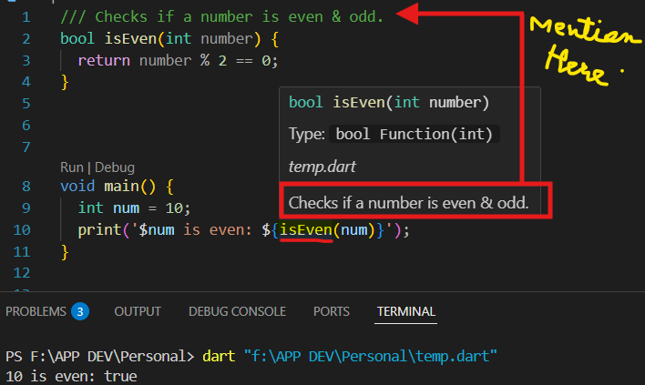

Sure! Here's a visually **improved and well-structured graphic-style explanation** of **Comments in Dart**, perfect for revision and understanding at a glance:

---

## 🎯 **1. What Are Comments in Dart?**

📝 **Comments** are notes in your code that **Dart ignores** at runtime.  
They help you **explain, document, and debug** your program.

---

## 🧩 **2. Types of Comments in Dart**

| Type                    | Syntax                  | Use Case                          |
|-------------------------|--------------------------|-----------------------------------|
| 🟦 Single-line          | `// comment`             | Short notes or explanations       |
| 🟨 Multi-line           | `/* comment */`          | Longer notes or block comments    |
| 🟩 Documentation        | `/// comment` or `/** */`| API or function/class docs        |

---

## 🤔 **3. Why Use Comments?**

✔️ Make your code easy to understand  
✔️ Explain *why*, not just *what*  
✔️ Help others (or future-you!) read your code  
✔️ Generate documentation using `///`  
✔️ Temporarily disable code for testing/debugging  

---

## 🛠️ **4. How to Use Them?**

🔹 **Single-line**  
```dart
// This is a single-line comment
int x = 5;
```

🔹 **Multi-line**  
```dart
/*
This is a multi-line comment.
Useful for explaining big chunks.
*/
```

🔹 **Documentation**  
```dart
/// This function adds two numbers.
int add(int a, int b) => a + b;
```

---

## 💡 **5. Example with Output**

```dart
void main() {
  // Circle's radius
  double r = 4;

  // Calculate area
  double area = 3.14 * r * r;

  // Print result
  print("Area: $area");
}
```

🖨️ **Output:**
```
Area: 50.24
```

🔍 **Explanation**: Comments guide through the logic — define radius ➝ calculate ➝ print.

---

## 🌍 **6. Real-World Example with Documentation**

```dart
/// Returns true if number is even
bool isEven(int number) {
  return number % 2 == 0;
}

void main() {
  int n = 10;
  print('$n is even: ${isEven(n)}');
}
```

🖨️ **Output:**
```
10 is even: true
```



🔍 **Explanation**: Real-world logic to check even numbers, and `///` helps generate docs.

---

## 📏 **7. Comment Rules**

✅ Be **clear**, **short**, and **relevant**  
❌ Don't state the obvious (`int x = 5; // set x to 5`)  
🛠 Keep them **updated**  
📚 Use `///` for **public API documentation**

---

## 🧠 **8. Real-World Knowledge & Practice Q&A**

| ❓ Question | ✅ Answer |
|------------|----------|
| What is the use of `///` in Dart? | To generate documentation for classes, methods, etc. |
| How can comments help debugging? | Temporarily disable code blocks without deleting |
| When to use `/* */` vs `//`? | Use `/* */` for multiple lines, `//` for single lines |
| Are comments executed? | ❌ No, they are ignored at compile and runtime |

---
<br>
<br>
<p align="center">
  <a href="https://github.com/MANAV-PATEL13/DART/tree/main/Dart/Variable%20And%20Data%20type#-data-type-" style="float: left;">⬅️ Variable</a>
  |
  <a href="https://github.com/MANAV-PATEL13/DART/blob/main/Dart/Variable%20And%20Data%20type/README.md">🏠 Home</a>
  |
  <a href="https://github.com/MANAV-PATEL13/DART/tree/main/Dart/Metadata#-metadata" style="float: right;">  Metadata ➡️</a>
</p>